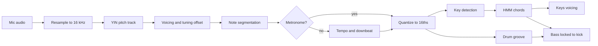

# HumBand

Hum a melody and get a whole band. HumBand listens to your humming, turns it into notes, then writes chords, a bass line and drums that fit what you hummed. It all runs in the browser with no backend, no build step and no audio samples. Every sound is synthesized live with the Web Audio API.

**Live demo** `https://<your-username>.github.io/humband/`

## What it does

- **Record a hum** with a count-in metronome, or hum freely and let it detect the tempo
- **See your voice** as a live pitch trace while you record, then overlaid on the corrected notes
- **Get an arrangement** in five styles (pop, lo-fi, hip-hop, rock, house) with chords, bass, keys and drums
- **Regenerate any part** with a creativity control, or shuffle everything
- **Edit the melody** by clicking the piano roll
- **Mix** with per-track volume and mute, including your original take lined up to the beat
- **Neural drums (optional)** from Google Magenta's DrumsRNN, loaded on demand
- **Export** a multitrack MIDI file for any DAW, or a rendered WAV

## How it works



### Listening

**Pitch tracking.** The YIN algorithm (de Cheveigné and Kawahara, 2002) runs every 10 ms. For each frame it measures how different the signal is from a copy of itself shifted by `tau` samples, normalizes that curve, and takes the first deep dip as the period. Parabolic interpolation gives sub-sample accuracy.

**Tuning.** Most people hum a bit sharp or flat overall. Each voiced frame's pitch is treated as an angle on the semitone circle, and the energy-weighted circular mean gives the global offset. Notes are corrected by that amount before rounding, so a consistently flat hum still lands on the right notes.

**Note segmentation.** A note starts when the pitch moves more than 0.75 semitones from the current note and holds there for 40 ms, or when the loudness dips by 6 dB and comes back (a repeated note). Short glides between notes get split between their neighbors, and scoops at the start of a note are ignored when picking its pitch.

**Timing.** In metronome mode the recording is aligned using the audio clock frame stamped on every chunk by an AudioWorklet, minus the measured input and output latency. A small search then finds the shift (within 45 ms) that best fits the onsets to the 16th grid. Notes hummed just before the downbeat are treated as pickups and wrap to the end of the loop.

**Free tempo.** Without a metronome, each candidate tempo maps every onset to an angle around a circle one grid step long. When onsets really sit on that grid the angles pile up and their mean vector is long (the Rayleigh resultant). Scores at the 16th, 8th and quarter-note levels are combined with a prior toward everyday tempos. Double versus half time is genuinely ambiguous, so the app offers half and double tempo buttons, plus a control to move the bar line.

### Writing the band

**Key.** The duration-weighted pitch class histogram of the melody is correlated against the 24 Krumhansl-Kessler key profiles, with a small bonus for melodies that end on the tonic.

**Chords.** A hidden Markov model whose states are the diatonic chords of the key. Emission scores reward melody notes that are chord tones (more on strong beats) and penalize clashes. Transitions encode common moves like V to I and IV to V. Because the result loops, Viterbi runs once per possible first chord with the wrap-around transition added, which solves the cyclic case exactly. To regenerate, Gumbel noise is added to the emissions before decoding (perturb-and-MAP), which samples a different but still likely progression.

**Keys.** Each chord is voiced by trying every inversion in range and keeping the one with the least total movement from the previous chord.

**Drums.** Each style is a template of hit probabilities per 16th step. Optional kicks become much more likely on steps where you started a note, so the groove follows your rhythm. Busier melodies get busier hats, and the loop can end with a fill.

**Bass.** Locks to the kick drum, plays the root on chord changes, adds fifths and octaves, and sometimes walks into the next chord with a diatonic passing note.

**Neural drums.** Magenta's DrumsRNN continues a drum pattern but knows nothing about your melody. HumBand seeds it with the first bar of the built-in groove, asks for a few continuations, and keeps the one whose kicks and snares line up best with your note onsets. If the model can't load, the built-in drums keep playing.

**Playback.** A lookahead scheduler wakes every 25 ms and schedules everything in the next 120 ms on the audio clock, so timing never depends on the main thread. The same instruments render offline to WAV through an OfflineAudioContext.

## Run it locally

The microphone only works on `https` or `localhost`, so serve the folder rather than opening the file directly.

```bash
cd humband
python3 -m http.server 5173
# then open http://localhost:5173
```

Or with Node installed, `npm start`.

## Deploy to GitHub Pages

1. Push the repo to GitHub
2. Go to **Settings → Pages**
3. Under **Build and deployment**, pick **Deploy from a branch**, then `main` and `/ (root)`
4. Wait a minute and the app is live at `https://<your-username>.github.io/humband/`

## Tests

```bash
npm test
```

The analysis and music code has no browser dependencies, so it runs in Node. The suite synthesizes hums with realistic flaws (scoops, vibrato, drift, a tuning offset, sloppy timing and room noise) and checks that they transcribe back to the right notes. It also covers a low male-range hum, a minor key tune with a pickup, free-tempo detection across several tempos, key detection, every style's arrangement, and that the MIDI export parses back with every note.

## Project structure

```
index.html, styles.css
src/
  main.js                 app state and UI wiring
  demo-hum.js             synthetic hum for the demo button and tests
  analysis/
    dsp.js                resampling, filtering, stats
    pitch.js              YIN pitch detection
    notes.js              voicing, tuning, segmentation, quantization
    tempo.js              free-tempo and downbeat estimation
    pipeline.js           audio in, quantized melody out
  music/
    theory.js             scales, key detection, chord vocabulary
    harmony.js            HMM chord model
    styles.js             style recipes
    drums.js, bass.js, comp.js
    arrange.js            puts the generators together
    random.js             seeded randomness
  audio/
    capture-worklet.js    mic capture on the audio thread
    recorder.js           microphone and latency handling
    instruments.js        synthesized instruments, drum kit, mixer
    player.js             lookahead scheduler
    render.js             offline WAV render
  ai/neural-drums.js      Magenta DrumsRNN, generate and rank
  io/midi.js, io/wav.js   exporters
  ui/pianoroll.js, ui/livepitch.js
test/pipeline.test.js
```

## Limitations and ideas

- Melodies are monophonic and chords are diatonic triads or sevenths, so borrowed chords and key changes aren't modeled yet
- Free-tempo mode can pick double or half time on slow songs (one tap fixes it)
- Ideas for later include swing detection from the hum itself, a neural transcription model like Spotify's Basic Pitch for comparison, stem export, and a looper for layering several hums

## License

MIT
